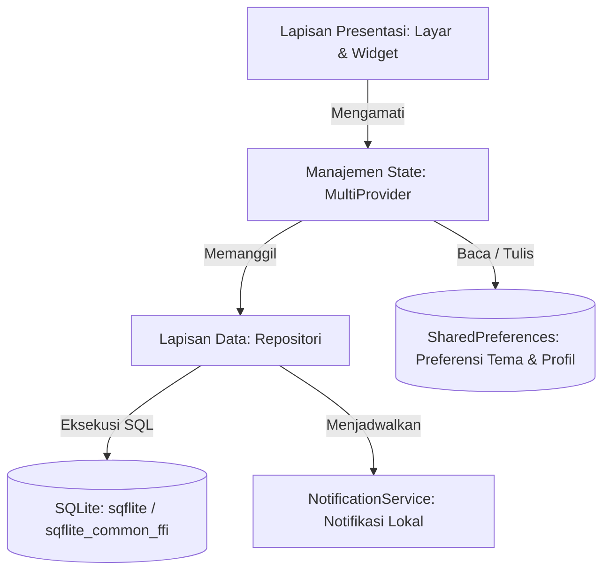

<div align="center">

  

  # CashBay

  **Aplikasi pencatatan keuangan pribadi modern berbasis offline-first dengan privasi total, penyimpanan SQLite deterministik, dan antarmuka Material 3.**

  [](https://flutter.dev)
  [](https://dart.dev)
  [](#dukungan-platform)
  [-003B57?style=for-the-badge&logo=sqlite&logoColor=white)](https://www.sqlite.org)
  [](#lisensi)

  <br />

  [English](README.md) • [Bahasa Indonesia](README.id.md)

</div>

---

## 📌 Daftar Isi

- [Gambaran Umum](#-gambaran-umum)
- [Fitur Utama](#-fitur-utama)
- [Arsitektur & Tumpukan Teknologi](#-arsitektur--tumpukan-teknologi)
- [Struktur Database & Aturan Domain](#-struktur-database--aturan-domain)
- [Struktur Direktori](#-struktur-direktori)
- [Memulai](#-memulai)
  - [Prasyarat](#prasyarat)
  - [Instalasi](#instalasi)
  - [Menjalankan Aplikasi](#menjalankan-aplikasi)
- [Pengujian & Jaminan Kualitas](#-pengujian--jaminan-kualitas)
- [Build & CI/CD](#-build--cicd)
- [Konfigurasi & Personalisasi](#-konfigurasi--personalisasi)
- [Kontribusi](#-kontribusi)
- [Lisensi](#-lisensi)

---

## 📖 Gambaran Umum

**CashBay** adalah aplikasi manajemen keuangan pribadi *offline-first* berstandar *engineering* yang dibangun menggunakan Flutter. Dirancang untuk pengguna yang mengutamakan privasi data tanpa kompromi, CashBay menyimpan 100% data secara lokal di dalam database SQLite perangkat.

Aplikasi ini beroperasi tanpa backend server, tanpa telemetri pelacakan pihak ketiga, dan tanpa ketergantungan sinkronisasi cloud. Anda memegang kendali penuh atas data finansial Anda, dilengkapi fungsionalitas ekspor dan impor berbasis JSON untuk pencadangan mandiri.

### Prinsip Utama

1. **Privasi Penuh**: Tanpa telemetri pihak ketiga, tanpa panggilan API eksternal. Seluruh catatan keuangan berada sepenuhnya di tangan pengguna.
2. **Integritas Buku Besar**: Batasan integritas database yang ketat, audit *soft-delete*, serta kalkulasi saldo yang konsisten dan matematis di seluruh dompet.
3. **Pengalaman Pengguna Elegan**: Implementasi penuh Material 3, pilihan palet warna dinamis (*seed color*), mode terang/gelap, tipografi Plus Jakarta Sans, dan sentuhan aksen motif Batik Indonesia.

---

## ✨ Fitur Utama

| Domain | Fitur | Penjelasan |
|---|---|---|
| **Dompet & Saldo** | Manajemen Multi-Dompet | Kelola berbagai akun keuangan (Tunai, E-Wallet, Rekening Bank) dengan saldo terpisah. |
| **Siklus Transaksi** | Ragam Kategori & Multi-Tag | Klasifikasikan transaksi sebagai **Pendapatan**, **Pengeluaran**, **Transfer**, atau **Titipan** dengan dukungan multi-kategori. |
| | Audit & Penghapusan Lunak (*Soft Delete*) | Transaksi yang dihapus ditandai dengan `is_deleted = 1` untuk menjaga riwayat buku besar tetap utuh. |
| | Metadata Lengkap | Sertakan deskripsi, catatan tambahan, dan lampiran foto/bukti transaksi (`image_picker`). |
| **Tagihan & Titipan** | Utang & Piutang | Pantau utang/piutang dengan riwayat cicilan bertahap (*installment ledger*) dan status pelunasan otomatis. |
| | Pengingat Jatuh Tempo | Notifikasi lokal terjadwal via `flutter_local_notifications` untuk tagihan yang mendekati tanggal jatuh tempo. |
| **Analitik & Laporan** | Rasio Kesehatan Finansial | Metrik komputasi langsung: **Burn Rate**, **Arus Kas Bersih (Net Cash Flow)**, **Rasio Tabungan**, dan **Rasio Pengeluaran**. |
| | Visualisasi Data | Grafik batang interaktif bulanan ditenagai oleh `fl_chart` dengan navigasi tahunan. |
| **Kedaulatan Data** | Pencadangan & Pemulihan | Ekspor dan impor seluruh data aplikasi dalam format JSON terstandarisasi melalui `file_selector`. |
| | Reset Pabrik | Pembersihan menyeluruh data lokal dan preferensi secara aman sesuai kebutuhan. |
| **Personalisasi** | Tema & Bahasa | Palet Material 3 dinamis dari *seed color*, mode Terang/Gelap/Sistem, serta dukungan dwibahasa (**Bahasa Indonesia** & **English**). |

---

## 🛠 Arsitektur & Tumpukan Teknologi

CashBay mengadopsi pola **Feature-Driven Architecture** dengan pemisahan tanggung jawab yang jelas antar lapisan:



### Rincian Teknologi

- **Framework**: [Flutter](https://flutter.dev) (Dart SDK `^3.12.0`)
- **Manajemen State**: `Provider` (`MultiProvider`, `ChangeNotifier`)
- **Penyimpanan Lokal**:
  - `sqflite` (Skema v6) untuk platform seluler
  - `sqflite_common_ffi` untuk pengujian dan eksekusi desktop
  - `shared_preferences` untuk tema, preferensi bahasa, dan profil
- **UI & Grafis**:
  - Material 3 Design System dengan `ColorScheme.fromSeed`
  - `fl_chart` untuk visualisasi performa keuangan
  - Font Plus Jakarta Sans
- **Integrasi Sistem**:
  - `flutter_local_notifications` & `timezone` untuk pengingat jatuh tempo lokal
  - `file_selector` & `path_provider` untuk pengelolaan berkas cadangan JSON
  - `image_picker` untuk lampiran struk/nota

---

## 🗄 Struktur Database & Aturan Domain

Database SQLite lokal berjalan pada **Skema v6** dan tunduk pada aturan domain yang ketat guna memastikan integritas catatan finansial.

### Tabel Utama

- `wallets`: Menyimpan data dompet/akun (`id`, `name`, `type`, `balance`).
- `categories`: Master kategori pendapatan dan pengeluaran (`id`, `name`, `type`, `icon`, `is_default`).
- `transactions`: Buku besar transaksi utama (`id`, `wallet_id`, `type`, `amount`, `date`, `description`, `note`, `photo_path`, `is_deleted`, `is_titipan`, `related_wallet_id`).
- `transaction_tags`: Tabel pivot hubungan *Many-to-Many* antara `transactions` dan `categories`.
- `debts`: Entri utang, piutang, dan titipan (`id`, `name`, `type`, `total_amount`, `remaining_amount`, `due_date`, `status`, `open_txn_id`).
- `debt_payments`: Riwayat pembayaran bertahap (cicilan) untuk setiap tagihan.

### Aturan Matematis Saldo

Saldo setiap dompet dihitung secara deterministik dengan formula:

$$\text{Saldo} = \sum \text{Pendapatan} - \sum \text{Pengeluaran} - \sum \text{Transfer}_{\text{Keluar}} + \sum \text{Transfer}_{\text{Masuk}}$$

*Transaksi dengan status `is_deleted = 1` dikecualikan secara mutlak dari perhitungan saldo.*

### Aturan Domain

1. **Penghapusan Lunak (*Soft Delete*)**: Menghapus transaksi akan mengubah kolom `is_deleted = 1`. Baris data tetap berada di SQLite untuk mempertahankan rekam jejak audit (*audit trail*).
2. **Kekekalan Tipe Transaksi**: Untuk menjaga konsistensi buku besar, tipe transaksi yang telah dibuat tidak dapat diubah; pembaruan hanya diperbolehkan untuk deskripsi, catatan, nominal, kategori, tanggal, dan lampiran.
3. **Siklus Hidup Titipan**: Transaksi titipan awal mencatat mutasi saldo dompet pembuka dengan tanda `is_titipan = 1`. Status ini mengisolasi pergerakan saldo dari agregasi pendapatan atau pengeluaran murni hingga pembayaran terjadi.

---

## 📂 Struktur Direktori

```text
CashBay/
├── .github/
│   └── workflows/
│       └── build.yml               # Otomasi CI untuk build APK, AAB, dan IPA
├── lib/
│   ├── app.dart                    # Inisialisasi aplikasi & pendaftaran MultiProvider
│   ├── main.dart                   # Titik masuk utama, konfigurasi lokal & preferensi
│   ├── core/                       # Modul bersama lintas fitur
│   │   ├── constants/              # Konstanta aplikasi
│   │   ├── database/               # AppDatabase (skema v6, migrasi tabel)
│   │   ├── extensions/             # Ekstensi helper Dart
│   │   ├── services/               # NotificationService (pengingat jatuh tempo)
│   │   ├── theme/                  # ThemeProvider, FinanceColors, AppTheme
│   │   ├── utils/                  # CurrencyFormatter, DateFormatter, Validasi
│   │   └── widgets/                # AppCard, TransactionTile, AppBottomNav
│   ├── features/                   # Modul fitur berbasis domain
│   │   ├── dashboard/              # Ringkasan saldo, kartu dompet, transaksi terbaru
│   │   ├── transactions/           # Tambah/ubah transaksi, riwayat, detail
│   │   ├── debts/                  # Tagihan utang/piutang, titipan, cicilan
│   │   ├── categories/             # Manajemen kategori
│   │   ├── report/                 # Analitik keuangan, grafik batang, metrik
│   │   ├── profile/                # Data profil lokal pengguna
│   │   └── settings/               # Pengaturan tema, bahasa, ekspor/impor JSON
│   └── l10n/                       # Berkas lokalisasi (.arb)
├── public/                         # Aset visual: ikon, font, pola batik
├── test/                           # Rangkaian pengujian unit dan widget
├── integration_test/               # Pengujian integrasi end-to-end
└── pubspec.yaml                    # Konfigurasi dependensi dan aset
```

---

## 🚀 Memulai

### Prasyarat

Pastikan komponen berikut telah terpasang di sistem operasi Anda:

- **Flutter SDK**: `>= 3.12.0` ([Panduan Instalasi Flutter](https://docs.flutter.dev/get-started/install))
- **Dart SDK**: `>= 3.12.0` (disertakan bersama Flutter)
- **Java Development Kit**: JDK 17 (untuk kompilasi Android)
- **Android Studio / Xcode**: Terpasang dengan platform SDK yang sesuai

### Instalasi

1. Klon repositori ini:
   ```bash
   git clone https://github.com/your-username/CashBay.git
   cd CashBay
   ```

2. Unduh dependensi proyek:
   ```bash
   flutter pub get
   ```

3. Bangkitkan berkas lokalisasi:
   ```bash
   flutter gen-l10n
   ```

### Menjalankan Aplikasi

Jalankan pada target perangkat yang diinginkan:

```bash
# Jalankan pada perangkat Android atau iOS yang terhubung
flutter run

# Jalankan pada desktop Windows
flutter run -d windows
```

---

## 🧪 Pengujian & Jaminan Kualitas

CashBay dilengkapi dengan rangkaian pengujian unit, widget, dan integrasi. Akses database SQLite distub secara otomatis menggunakan `sqflite_common_ffi` pada lingkungan *headless*.

```bash
# Menjalankan static analysis dan linting
flutter analyze

# Menjalankan pengujian unit dan widget (disarankan concurrency 1 untuk pengujian database)
flutter test --concurrency=1

# Menjalankan pengujian spesifik
flutter test test/widget_test.dart

# Menjalankan pengujian integrasi di Windows
flutter test integration_test/ -d windows
```

---

## 📦 Build & CI/CD

Otomatisasi pengemasan aplikasi dikelola melalui GitHub Actions (`.github/workflows/build.yml`) setiap kali tag versi dirilis (misal `v1.0.0`):

```bash
# Menghasilkan APK Android (Release)
flutter build apk --release

# Menghasilkan Android App Bundle untuk Google Play Store (Release)
flutter build appbundle --release

# Menghasilkan arsip iOS tanpa tanda tangan digital
flutter build ios --release --no-codesign
```

Paket installer yang berhasil dibangun dapat diunduh langsung dari tab *Artifacts* pada GitHub Actions.

---

## ⚙ Konfigurasi & Personalisasi

| Pengaturan | Opsi | Lokasi |
|---|---|---|
| **Mode Tema** | `Sistem`, `Terang`, `Gelap` | Layar Pengaturan |
| **Warna Aksen** | Palet preset atau pemilih warna dinamis | Layar Pengaturan |
| **Bahasa** | `id` (Bahasa Indonesia), `en` (English) | `lib/l10n/*.arb` |
| **Migrasi Database** | Manajemen versi skema SQLite | `lib/core/database/app_database.dart` |

---

## 🤝 Kontribusi

Kontribusi dari komunitas sangat disambut baik. Mohon ikuti alur kerja berikut:

1. **Fork** repositori dan buat branch fitur baru:
   ```bash
   git checkout -b feature/nama-fitur-anda
   ```
2. Pastikan kode memenuhi aturan linter:
   ```bash
   flutter analyze
   ```
3. Pastikan seluruh pengujian berhasil tanpa kegagalan:
   ```bash
   flutter test --concurrency=1
   ```
4. Buat commit perubahan dengan deskripsi yang jelas dan terstruktur:
   ```bash
   git commit -m "feat(transactions): tambah filter multi-tag pada riwayat"
   ```
5. Push ke branch Anda dan buat **Pull Request**.

---

## 📄 Lisensi

Proyek ini bersifat sumber terbuka (*open source*) di bawah naungan [MIT License](LICENSE).

---

<div align="center">
  <sub>Dibangun dengan ketelitian rekayasa untuk privasi dan kejernihan catatan finansial pribadi.</sub>
</div>
