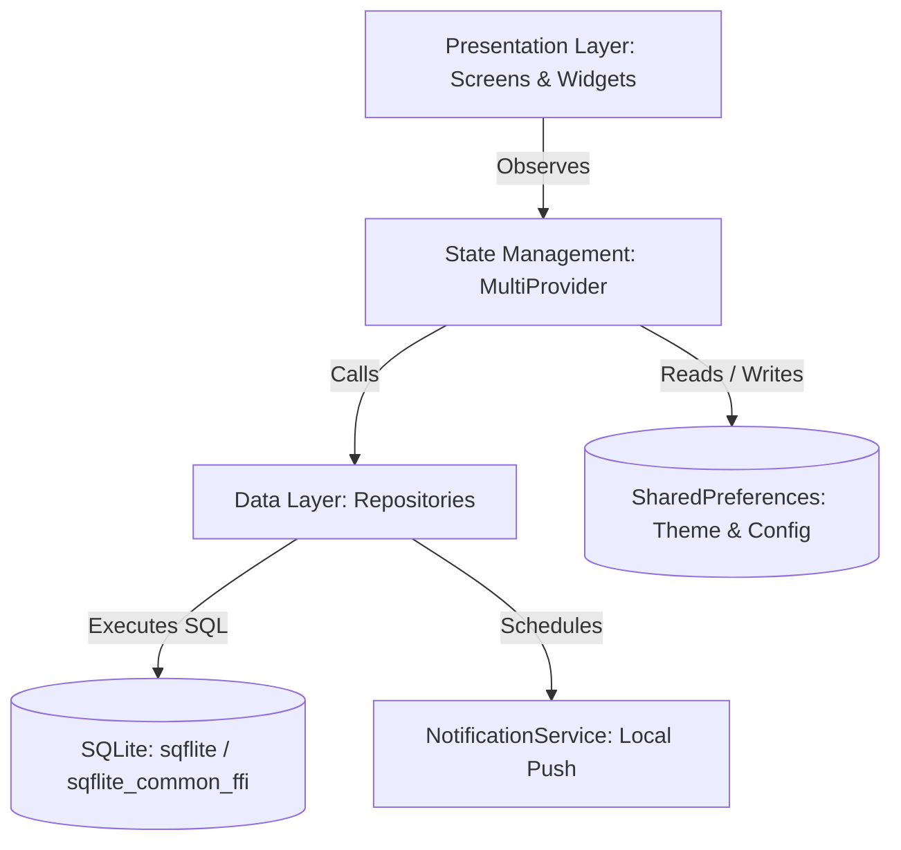

<div align="center">

  

  # CashBay

  **A modern, offline-first personal finance tracker with zero telemetry, robust SQLite storage, and Material 3 design.**

  [](https://flutter.dev)
  [](https://dart.dev)
  [](#platform-support)
  [-003B57?style=for-the-badge&logo=sqlite&logoColor=white)](https://www.sqlite.org)
  [](#license)

  <br />

  [English](README.md) • [Indonesian](README.id.md)

</div>

---

## 📌 Table of Contents

- [Overview](#-overview)
- [Key Features](#-key-features)
- [Architecture & Tech Stack](#-architecture--tech-stack)
- [Database & Domain Invariants](#-database--domain-invariants)
- [Directory Structure](#-directory-structure)
- [Getting Started](#-getting-started)
  - [Prerequisites](#prerequisites)
  - [Installation](#installation)
  - [Running the App](#running-the-app)
- [Testing & Quality Assurance](#-testing--quality-assurance)
- [Building & CI/CD](#-building--cicd)
- [Configuration & Customization](#-configuration--customization)
- [Contributing](#-contributing)
- [License](#-license)

---

## 📖 Overview

**CashBay** is an engineering-grade, offline-first personal finance application crafted with Flutter. Designed for users who demand strict data privacy and deterministic financial records, CashBay stores 100% of its data locally in an SQLite database.

There are no remote backends, no tracking analytics, and no cloud synchronization requirements. You retain absolute ownership of your financial records, coupled with JSON-based import and export capabilities for seamless backups.

### Core Philosophy

1. **Absolute Privacy**: Zero third-party telemetry, zero external database calls. Your financial status stays solely on your device.
2. **Deterministic Ledger**: Strict database constraints, soft-delete auditability, and mathematically consistent balance computation across multiple wallets.
3. **Refined UX**: Complete Material 3 adaptation, customizable seed colors, dark/light modes, Plus Jakarta Sans typography, and contextual Indonesian Batik motif accents.

---

## ✨ Key Features

| Domain | Feature | Description |
|---|---|---|
| **Wallets & Balances** | Multi-Wallet Support | Track multiple financial accounts (Cash, E-Wallets, Bank Accounts) with independent balances. |
| **Transaction Lifecycle** | Comprehensive Categories | Categorize records as **Income**, **Expense**, **Transfer**, or **Titipan** with multi-tagging capability. |
| | Audit & Soft Delete | Non-destructive soft deletion (`is_deleted = 1`) preserves transactional history and prevents ledger corruptions. |
| | Rich Metadata | Attach descriptions, notes, and receipts/photo attachments (`image_picker`) to every transaction. |
| **Debt & Titipan** | Receivables & Payables | Manage debts with partial payment/installment tracking, remaining balance ledger, and settlement status. |
| | Due Date Notifications | Scheduled on-device alerts via `flutter_local_notifications` for pending debts and titipan deadlines. |
| **Analytics & Reports** | Financial Health Metrics | Real-time analytics calculating **Burn Rate**, **Net Cash Flow**, **Savings Ratio**, and **Expense Ratio**. |
| | Visual Breakdown | Interactive monthly bar charts powered by `fl_chart` with year-over-year traversal. |
| **Data Sovereignty** | Backup & Recovery | One-click full export and import of application state into standardized JSON format via `file_selector`. |
| | Factory Reset | Secure, complete purging of local database and preferences on demand. |
| **Personalization** | Theming & Localization | Dynamic Material 3 seed palettes, Light/Dark/System theme toggles, and dual localization (**Indonesian** & **English**). |

---

## 🛠 Architecture & Tech Stack

CashBay follows a **Feature-Driven Architecture** with clear boundaries between the presentation, domain, and data layers:



### Technology Highlights

- **Framework**: [Flutter](https://flutter.dev) (Dart SDK `^3.12.0`)
- **State Management**: `Provider` (`MultiProvider`, `ChangeNotifier`)
- **Persistence Engine**:
  - `sqflite` (Schema v6) for mobile devices
  - `sqflite_common_ffi` for desktop testing and execution
  - `shared_preferences` for theme, localization, and user profile metadata
- **Visuals & UX**:
  - Material 3 Design System with `ColorScheme.fromSeed`
  - `fl_chart` for responsive charting
  - Plus Jakarta Sans variable font family
- **System Integrations**:
  - `flutter_local_notifications` & `timezone` for offline schedule management
  - `file_selector` & `path_provider` for cross-platform backup handling
  - `image_picker` for receipt attachment storage

---

## 🗄 Database & Domain Invariants

The local database runs on **Schema v6** and adheres to strict domain invariants to preserve ledger integrity.

### Tables

- `wallets`: Holds wallet records (`id`, `name`, `type`, `balance`).
- `categories`: Master income and expense tags (`id`, `name`, `type`, `icon`, `is_default`).
- `transactions`: Core ledger table (`id`, `wallet_id`, `type`, `amount`, `date`, `description`, `note`, `photo_path`, `is_deleted`, `is_titipan`, `related_wallet_id`).
- `transaction_tags`: Pivot table providing Many-to-Many associations between `transactions` and `categories`.
- `debts`: Titipan/receivables/payables ledger (`id`, `name`, `type`, `total_amount`, `remaining_amount`, `due_date`, `status`, `open_txn_id`).
- `debt_payments`: Audit table tracking partial repayments against a debt record.

### Core Mathematical Invariant

Wallet balances are deterministically recomputed and verified via:

$$\text{Balance} = \sum \text{Income} - \sum \text{Expense} - \sum \text{Transfer}_{\text{out}} + \sum \text{Transfer}_{\text{in}}$$

*Transactions with `is_deleted = 1` are strictly excluded from balance computations.*

### Domain Rules

1. **Soft Delete**: Deleting a transaction updates `is_deleted = 1`. The original transaction row remains in SQLite to protect historical audit trails.
2. **Immutable Transaction Type**: To avoid ledger inconsistencies, existing transaction types (`income`, `expense`, `transfer`, `titipan`) are immutable upon edit; only descriptions, notes, amounts, tags, and attachments may be adjusted.
3. **Titipan Lifecycle**: An initial titipan operation shifts the active wallet balance via an opening leg transaction flagged with `is_titipan = 1`. This isolates the movement from regular income/expense calculations until debt settlements occur.

---

## 📂 Directory Structure

```text
CashBay/
├── .github/
│   └── workflows/
│       └── build.yml               # Automated CI build for APK, AAB, and IPA
├── lib/
│   ├── app.dart                    # Application root & MultiProvider registry
│   ├── main.dart                   # Bootstrap, locale setup & shared prefs init
│   ├── core/                       # Shared platform components
│   │   ├── constants/              # Application-wide constants
│   │   ├── database/               # AppDatabase (v6 schema, migrations, tables)
│   │   ├── extensions/             # Dart extensions & helper utilities
│   │   ├── services/               # NotificationService (local reminder dispatcher)
│   │   ├── theme/                  # ThemeProvider, FinanceColors, AppTheme
│   │   ├── utils/                  # CurrencyFormatter, DateFormatter, Validators
│   │   └── widgets/                # AppCard, TransactionTile, AppBottomNav
│   ├── features/                   # Domain features (feature-first)
│   │   ├── dashboard/              # Balance overview, wallet cards, recent txns
│   │   ├── transactions/           # Add/edit transaction, history, details
│   │   ├── debts/                  # Titipan, receivables, installments ledger
│   │   ├── categories/             # Custom & default category management
│   │   ├── report/                 # Monthly bar charts, metrics, ratios
│   │   ├── profile/                # Local profile preferences
│   │   └── settings/               # Theme, language, JSON backup & reset
│   └── l10n/                       # Localization definitions (.arb)
├── public/                         # App icons, fonts, and batik pattern assets
├── test/                           # Unit and widget test suite
├── integration_test/               # End-to-end integration test suite
└── pubspec.yaml                    # Package manifest & assets registration
```

---

## 🚀 Getting Started

### Prerequisites

Ensure the following dependencies are installed on your host machine:

- **Flutter SDK**: `>= 3.12.0` ([Flutter Installation Guide](https://docs.flutter.dev/get-started/install))
- **Dart SDK**: `>= 3.12.0` (bundled with Flutter)
- **Java Development Kit**: JDK 17 (for Android packaging)
- **Android Studio / Xcode**: Configured SDK platforms and command-line tools

### Installation

1. Clone the repository:
   ```bash
   git clone https://github.com/your-username/CashBay.git
   cd CashBay
   ```

2. Retrieve project dependencies:
   ```bash
   flutter pub get
   ```

3. Generate localization files:
   ```bash
   flutter gen-l10n
   ```

### Running the App

Select your target execution environment:

```bash
# Run on connected Android or iOS device
flutter run

# Run on desktop (Windows)
flutter run -d windows
```

---

## 🧪 Testing & Quality Assurance

CashBay contains comprehensive unit, widget, and integration test suites. The SQLite database is stubbed in automated tests using `sqflite_common_ffi`.

```bash
# Execute static analysis and linting
flutter analyze

# Execute unit and widget test suite (concurrency 1 recommended for DB tests)
flutter test --concurrency=1

# Run a specific widget test
flutter test test/widget_test.dart

# Run integration tests on Windows / desktop
flutter test integration_test/ -d windows
```

---

## 📦 Building & CI/CD

Continuous integration is orchestrated through GitHub Actions (`.github/workflows/build.yml`), triggering on version tags (e.g., `v1.0.0`):

```bash
# Build Android APK (Release)
flutter build apk --release

# Build Android App Bundle for Google Play Store (Release)
flutter build appbundle --release

# Build iOS Archive (Unsigned)
flutter build ios --release --no-codesign
```

Built artifacts are automatically stored and made available under GitHub Actions artifacts.

---

## ⚙ Configuration & Customization

| Setting | Options | Location |
|---|---|---|
| **Theme Mode** | `System`, `Light`, `Dark` | Settings Screen |
| **Accent Seed Color** | Dynamic presets or custom color picker | Settings Screen |
| **Localization** | `id` (Indonesian), `en` (English) | `lib/l10n/*.arb` |
| **Database Migrations** | Schema version management | `lib/core/database/app_database.dart` |

---

## 🤝 Contributing

Contributions are welcomed. Please follow these conventions:

1. **Fork** the repository and create your feature branch:
   ```bash
   git checkout -b feature/your-feature-name
   ```
2. Adhere to `flutter_lints` rules:
   ```bash
   flutter analyze
   ```
3. Verify all existing and new tests pass:
   ```bash
   flutter test --concurrency=1
   ```
4. Commit your changes with descriptive messages:
   ```bash
   git commit -m "feat(transactions): add multi-tag filter to history"
   ```
5. Push to your branch and open a **Pull Request**.

---

## 📄 License

This project is open-source and distributed under the [MIT License](LICENSE).

---

<div align="center">
  <sub>Engineered with precision for personal privacy and financial clarity.</sub>
</div>
